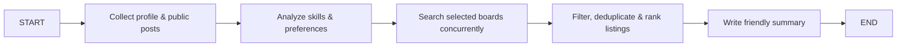

# CareerGlass

**Your next chapter. A clearer way to find it.**

A LangGraph-powered career companion with an Apple-inspired glassmorphism interface. Give it a LinkedIn profile, paste your skills and posts, or describe your ideal role. It searches **LinkedIn, Unstop, Internshala, and Wellfound**, ranks relevant jobs and internships, and explains your matches in a friendly, grounded LLM summary.

The supplied `reference_ui.png` informed the pastel palette, frosted panels, translucent controls, and liquid-glass hero artwork. It remains in the project root.

## Quick start

Requires **Python 3.11+** and internet access. No frontend build or Node.js installation is needed.

```bash
cd /home/stark/Documents/jobseeker
python3 -m venv .venv
source .venv/bin/activate
pip install -r requirements.txt

# Only if you do not already have a .env file:
cp .env.example .env

# Set your credentials in .env, then:
python run.py
```

Open **http://127.0.0.1:8000**.

For development with automatic reload:

```bash
uvicorn backend.main:app --reload --host 127.0.0.1 --port 8000
```

### Configuration

| Variable | Purpose |
| --- | --- |
| `OPENAI_API_KEY` | LLM provider API key |
| `OPENAI_MODEL` | Model supporting tool/function calling; default `gpt-4.1-mini` |
| `OPENAI_BASE_URL` | Optional OpenAI-compatible API endpoint |
| `TAVILY_API_KEY` | Tavily web search and profile extraction key |
| `HOST` | Default `127.0.0.1` |
| `PORT` | Default `8000` |

Keys are read on the server from `.env`, which is excluded by `.gitignore`. Restart after changing configuration. A provider key needs sufficient credit/quota; the health indicator checks configuration presence, not account billing.

To use Nebius like the original project, supply a Nebius key as `OPENAI_API_KEY`, set `OPENAI_BASE_URL=https://api.tokenfactory.nebius.com/v1`, and choose a currently available model that supports structured function calls.

To use **Gemini**, supply your Gemini key as `OPENAI_API_KEY` and set:

```dotenv
OPENAI_BASE_URL=https://generativelanguage.googleapis.com/v1beta/openai/
OPENAI_MODEL=gemini-3.1-flash-lite
```

The `OPENAI_*` names are shared configuration for OpenAI-compatible providers; Gemini requests go to Google. Model access varies by account. If Google returns a model-unavailable error, select an available text model with function-calling support. A 503 response indicates temporary provider overload.

Gemini 3 models use low reasoning effort for faster extraction. LLM responses are capped at 4,000 tokens, with a 45-second request timeout and one retry. Ranking runs in batches of six candidates with at most three concurrent batches. Successful batches are retained if another fails; if all batches fail, the app reports the actual provider error. If only the final AI overview fails, a clearly labeled basic summary preserves the assessed job cards.

**Try demo** works without credentials. Its sample person and companies are fictional and labeled accordingly. Demo profile/domain/location are fixed; selected sources and opportunity type filter the sample cards. Demo buttons open platform homepages, not fictitious application links.

## Using the app

1. Paste a `https://www.linkedin.com/in/your-name/` URL into the profile field or include it in your natural-language prompt.
2. Optionally open **Add skills, experience, or posts** and paste profile sections or your posts.
3. Describe your target role, such as:
   > I’m looking for remote AI internships. I’ve built Python and LangGraph projects and want to work on real products.
4. Set a preferred domain, location, and jobs/internships filter. Explicit form preferences take priority over text.
5. Select any combination of the four platforms and click **Find my opportunities**.
6. Watch real workflow progress, read your summary, inspect match reasons, and open original listings.
7. Save cards with the heart button, inspect **My profile**, or export a Markdown report.

Saved cards persist in this browser’s local storage. Search results and profile insights otherwise live only in the current page session. Cancel stops the client request and propagates cancellation to the server workflow.

## LangGraph workflow



Each box is a real asynchronous LangGraph node in `backend/graph.py`:

1. **`collect_profile`** — Tavily extraction of the exact LinkedIn profile plus public profile/post searches. Filters unrelated profile URLs and post author slugs. Incorporates user-pasted information and reports missing evidence.
2. **`analyze_profile`** — Structured LLM extraction of supported skills, public-post themes, career direction, and search preferences. Explicit domain overrides inferred domain.
3. **`find_jobs`** — Concurrent domain-restricted Tavily searches across selected boards, with up to two role queries per board and a past-month search window. Keeps successful sources when another fails. Validates provider URLs and deduplicates tracking variants.
4. **`rank_jobs`** — Structured LLM assessment rejects category pages, unrelated roles, explicitly closed jobs, and preference conflicts. Application URLs come from provider evidence, never from generated text. Keeps up to 20 ranked matches.
5. **`summarize`** — Friendly explanation and next steps grounded in the profile, actual shortlist, and source limitations.

Estimated relevance uses a prompted rubric: skills 40%, domain 30%, seniority/type 20%, and location 10%. These are LLM estimates, not calibrated hiring probabilities.

The FastAPI route streams newline-delimited JSON progress events as graph nodes complete. It allows three simultaneous searches per server process and imposes a four-minute workflow deadline. Provider requests use bounded timeouts. No persistent LangGraph checkpointer is configured.

## What “LinkedIn analysis” and “available jobs” mean

- The app uses **publicly retrievable and indexed information**. It does not log in to LinkedIn, read private posts, bypass access controls, or guarantee that every public post is indexed.
- Post matches must have a URL author slug matching the supplied profile; ambiguous or differently formatted post URLs are excluded. This favors attribution over breadth.
- If public data is missing, paste your own profile and posts. The UI and report explain evidence gaps rather than fabricating your background.
- Job platforms are searched using **Tavily’s web index**, not authenticated first-party integrations. There is no guarantee of exhaustive coverage.
- Past-month search filtering improves freshness but does **not** verify that a listing is still open. Cards say “Search-index result • verify on source.” Check deadlines, eligibility, and availability on the original listing.
- Company, salary, location, and skills are shown only when available in returned evidence. A zero-result search is displayed honestly.
- Pasted posts can inform profile analysis, but independently discovered public-post themes are reported separately.

## Reference repository analysis

Original: [Arindam200/awesome-ai-apps — job_finder_agent](https://github.com/Arindam200/awesome-ai-apps/tree/main/advance_ai_agents/job_finder_agent)

The original `job_agents.py` chains six OpenAI Agents SDK agents: LinkedIn analysis, domain classification, YC board URL generation, job extraction, application URL rewriting, and final summarization. It uses Nebius-hosted Llama and Bright Data MCP. `app.py` provides a Streamlit interface. Its search targets Y Combinator rather than the platforms requested here.

This project is an independently written adaptation of that workflow:

| Original | CareerGlass |
| --- | --- |
| OpenAI Agents SDK sequential runners | Explicit typed LangGraph state and five asynchronous nodes |
| Streamlit | Responsive HTML/CSS/JavaScript interface, served by FastAPI |
| Bright Data MCP extraction | Tavily public extraction and domain-restricted web search |
| Y Combinator only | LinkedIn, Unstop, Internshala, Wellfound |
| Fixed inferred primary domain | Explicit domain/location/type plus natural-language intent |
| Profile analysis | Public profile and attributable post evidence, plus pasted details |
| Markdown output | Structured cards, estimated fit, friendly summary, saved list, Markdown export |
| Provider credentials needed immediately | Explicit zero-key demonstration mode |

No original source files or artwork were copied into the implementation. The reference image supplied by the user is retained locally. External fonts use Google Fonts with system-font fallbacks.

## Project layout

```text
jobseeker/
├── backend/
│   ├── main.py             # FastAPI routes and streamed execution
│   ├── graph.py            # LangGraph nodes, state, and graph
│   ├── providers.py        # OpenAI-compatible LLM and Tavily calls
│   ├── models.py           # Validated requests and structured output
│   └── demo.py             # Explicit fictional demonstration fixtures
├── frontend/
│   ├── index.html          # Accessible app shell
│   ├── style.css           # Responsive frosted/liquid-glass styling
│   └── app.js              # Stream handling, views, saves, and exports
├── tests/test_workflow.py  # Behavioral tests using mocked providers
├── reference_ui.png       # User-supplied visual reference
├── .env.example
├── .gitignore
├── requirements.txt
├── run.py
└── README.md
```

## API

- `GET /` — frontend
- `GET /api/health` — configuration readiness; never returns keys
- `POST /api/search` — validated input; NDJSON `started`, `progress`, `result`, or `error` events
- `GET /docs` — interactive OpenAPI documentation

Example:

```bash
curl -N http://127.0.0.1:8000/api/search \
  -H 'Content-Type: application/json' \
  -d '{"prompt":"Python and LangGraph internships","domain":"AI Engineering","location":"Remote","kind":"Internships","sources":["Unstop","Internshala"],"demo":false}'
```

Use `"demo":true` to exercise the complete graph without provider calls.

## Verification

```bash
source .venv/bin/activate
python -m unittest discover -s tests -v
node --check frontend/app.js  # Optional JavaScript syntax check
```

Tests cover profile URL validation, prompt URL extraction, public-post attribution, independent source failures, domain-focused queries, deduplication, hallucinated listing IDs, type/preferences filtering, demo isolation from providers, and API streaming/configuration errors.

## Troubleshooting

- **Live search needs keys:** configure both credentials and restart.
- **Provider request failed:** check the terminal error type/status code, account quota, model availability, and support for structured function calls. Raw provider payloads are not logged.
- **No available credit:** fund your LLM API account or replace the key with a funded one, then restart. ChatGPT subscriptions do not supply API billing credit.
- **AI provider took too long:** the error identifies the workflow stage. Retry or choose fewer platforms; the app uses small ranking batches to avoid oversized AI requests.
- **No LinkedIn content:** paste your profile details; public search and extraction cannot guarantee LinkedIn access.
- **No matches:** add skills, broaden location, select more boards, or adjust your preferred domain.
- **Port in use:** change `PORT` in `.env`.
- **Fonts look different offline:** system fonts automatically replace the optional web fonts.

This is a local single-user application. It does not include public multi-user authentication or a database. For a hosted deployment, configure authentication, per-user rate limits, and HTTPS before exposing billable provider endpoints.
# agent
